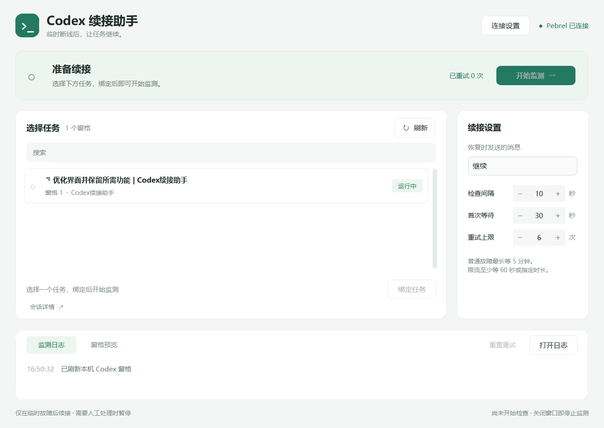
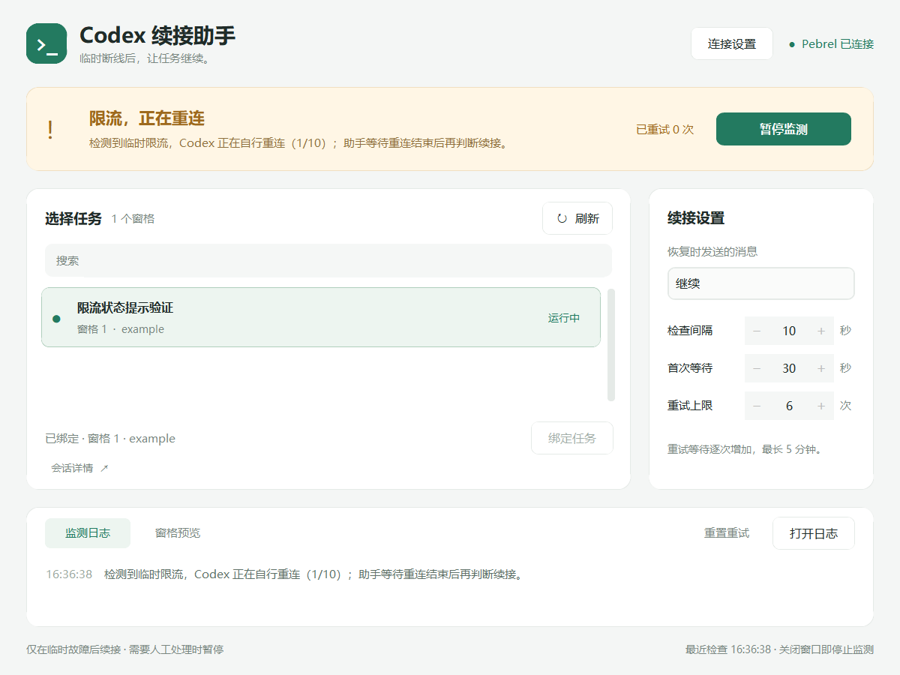

# Codex 续接助手

为 **Windows 上 Pebrel 终端中的 Codex CLI** 提供临时故障后的自动续接。在确认原会话、工作目录和输入状态后，按退避间隔发送“继续”。

[下载最新版本](https://github.com/Jonxinxin/codex-resume-helper/releases/latest) · [完整使用说明](使用说明.md) · [更新记录](CHANGELOG.md)



## 下载与运行

1. 从 [Releases](https://github.com/Jonxinxin/codex-resume-helper/releases) 下载 `CodexResumeHelper-v1.1.0-windows-x64.zip` 并完整解压。程序已包含 Python 运行环境。
2. 安装并打开 Pebrel。在 Pebrel 的 PowerShell 中进入解压目录，执行一次 `./install-connection.ps1`，登记当前用户的桌面连接。
3. 保持 Pebrel 和其中的 Codex 正常打开，双击 `Codex续接助手.exe`。
4. 点击 **刷新**，选择任务并 **绑定任务**；核对会话详情后点击 **开始监测**。

默认查找当前用户的 `%LOCALAPPDATA%\Programs\Pebrel\pebrel.exe`。使用自定义安装目录时，点击 **连接设置** 选择实际的 `pebrel.exe`。重开 Pebrel 后，在其中打开一个普通 PowerShell 窗格即可更新连接登记。

发布包面向 Windows 10/11 x64。现有适配范围为 Pebrel Runtime v1；项目此前在 Pebrel 2.0.0 (2122c62)、Codex CLI 0.158.0 上完成只读连接验证。其他版本请核对终端输出格式与连接情况。

## 功能

- 识别临时网络断开、超时、服务器错误、上游繁忙和临时限流。
- 等待 Codex 自行重连结束，并尊重终端显示的重试等待时间。
- 支持任务搜索、会话绑定、只读窗格预览和本地监测日志。
- 可调整续接消息、检查间隔、等待区间（最短/最长）和重试次数。
- 续接成功、或连续重试达到上限时，可通过飞书机器人推送一条提醒（可选）。
- 发送前复核会话和进程；持久化重试记录，避免结果不明时重复发送。
- 启动后需要手动绑定和开始；遇到已有草稿、权限请求、额度耗尽等情况交由用户处理。



## 工作方式与限制

助手调用本机 Pebrel CLI，不需要 API Key。连接凭据由 Windows DPAPI 按当前用户加密保存在 `%LOCALAPPDATA%\CodexResumeHelper`，聊天内容不会由助手上传。只有在你填入飞书 Webhook 后，助手才会在续接成功或放弃时向该地址发送一条状态摘要（任务名、目录、会话 ID、时间）。

本项目是第三方工具。它依靠可见终端文本判断故障，不能解除服务端限流，也不会自动重启已退出的 Codex。仅适用于本机 Pebrel 窗格；切换目标会话前应暂停监测。详细行为、退避规则及卸载连接登记的方法见 [使用说明](使用说明.md)。

## 从源码运行

开发与打包在 Windows x64、Python 3.14 上验证。建议使用独立虚拟环境：

```powershell
python -m venv .venv
.\.venv\Scripts\python.exe -m pip install -r requirements.txt
.\.venv\Scripts\python.exe app.py
```

## 测试与打包

```powershell
.\.venv\Scripts\python.exe -m pip install -r requirements-build.txt
.\build.ps1 -Python .\.venv\Scripts\python.exe -Version 1.1.0
```

构建脚本先运行核心逻辑、界面交互、连接登记和路径适配测试，通过后使用已提交的 PyInstaller spec 打包。界面测试需要 Windows 桌面环境，测试使用模拟任务。

输出为 `dist\Codex续接助手.exe`、`release\CodexResumeHelper-v1.1.0-windows-x64.zip` 和 `release\SHA256SUMS.txt`。ZIP 包含程序、连接安装脚本及使用说明。GitHub 自动提供对应版本的源码归档。
